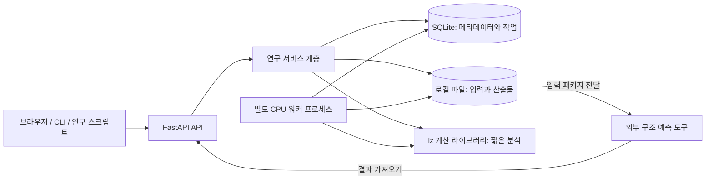

# LZ-program FastAPI 전환 아키텍처

작성일: 2026-10-18

기준 소스: `LZ-program/`, 커밋 `9b72e00cfd793a27de0bf37cccabea40064f9743`

문서 상태: 설계안 및 1차 구현 기준. FastAPI 입력·분석 API, SQLite 지속 작업, 별도 CPU 워커, 결과 다운로드와 보정 모델을 구현했다. 실행 방법은 [SERVER.md](SERVER.md)에 있다. Protein Lab 디자인의 TypeScript/Vite 웹 클라이언트도 구현했으며 [클라이언트 안내](client/README.md)에 사용법과 검증 범위를 정리했다. 아래 전체 설계 중 프로젝트별 관리와 외부 예측 결과 가져오기는 후속 범위다. 초기 저장 계층은 표준 라이브러리 sqlite3와 버전 마이그레이션으로 구현했으며 SQLAlchemy/Alembic은 아직 도입하지 않았다. 재시도는 새 run ID와 parent_id로 기록한다.

## 1. 전환 목표와 초기 범위

현재 프로그램은 연구 계산 라이브러리에 CLI와 Tkinter GUI가 연결된 구조다. 이를 **FastAPI 기반의 연구 실행·기록 서버**로 전환한다. 기존 계산 코드를 중심에 유지하고, 입력 검증·작업 관리·결과 보관·외부 도구 연결을 서비스 계층으로 모은다.

초기 사용 환경은 단일 연구자가 로컬 컴퓨터 또는 연구실의 단일 서버에서 사용하는 경우로 가정한다. 브라우저 UI는 API 위에 연결하며, 구체적인 프론트엔드 프레임워크는 별도 결정한다. 초기 API 검증은 OpenAPI 문서 화면으로 가능하게 한다.

첫 버전의 완료 범위:

- 서열/PDB 입력, 레지스터 분석, 점수 계산, 라이브러리 스크리닝.
- 파트너 설계·직교 세트 설계의 비동기 작업 실행과 상태 조회.
- 결과 및 재현 정보 저장, CSV/JSON/FASTA 다운로드.
- 보정 CSV 업로드와 보정 모델 버전 관리.
- 외부 구조 예측 입력 생성과 결과 파일 가져오기.

GPU 구조 예측 서버 운영, 실험장비 제어, 다중 기관 협업은 후속 확장 범위다. API 전환 자체가 생물학적 예측 정확도를 높이는 것은 아니므로, 평가 로직 개선은 별도 변경으로 추적한다.

## 2. 권장 전체 구조



외부 도구로의 전달은 초기에는 파일 다운로드/업로드 방식이다. 자동 실행을 지원하는 환경이 정해지면 어댑터를 추가한다.

| 계층 | 책임 | 경계 |
|---|---|---|
| API | HTTP 입력, 스키마 검증, 오류 응답, 파일 전달 | 과학 계산과 파일 경로 정책을 직접 구현하지 않음 |
| 서비스 | 대상 해석, 실행 조건 확정, 작업 생성, 결과 조합 | Tkinter·HTTP 객체에 의존하지 않음 |
| 계산 코어 | 레지스터, 점수, 최적화, 기하 분석 | DB·네트워크·웹 프레임워크에 의존하지 않음 |
| 워커 | 작업 확보, 실행, 진행률, 취소 확인, 산출물 확정 | API 프로세스 수명과 분리 |
| 저장소 | 실행·입력·모델·결과의 지속 저장 | 계산 모듈에 DB 모델을 전달하지 않음 |
| 외부 어댑터 | 예측/도킹 도구별 입출력 변환 | 도구 버전과 포맷 차이를 내부 모델로 변환 |

초기는 FastAPI/Uvicorn + Pydantic + SQLAlchemy/Alembic + SQLite + 로컬 파일을 제안한다. API 1개와 CPU 워커 1개로 시작하고, 다중 워커·다중 서버가 필요해질 때 PostgreSQL 및 작업 큐를 도입한다. Redis/Celery를 첫 버전의 필수 구성으로 두지 않는다.

## 3. 코드 재구성

```text
LZ-program/
├── lz/                         # 기존 계산 코어와 CLI
│   ├── heptad.py, scoring.py, params.py
│   ├── design.py, orthogonal.py, structure.py
│   ├── library.py, export.py, dockprep.py
│   ├── cli.py                  # 공통 서비스를 호출하도록 점진 전환
│   └── gui.py                  # 전환기 기존 클라이언트
├── server/
│   ├── main.py                 # 앱 구성, lifespan
│   ├── api/                    # targets, analyses, runs, artifacts 등
│   ├── schemas/                # 요청·응답 DTO
│   ├── services/               # 분석·설계·재평가·내보내기 유스케이스
│   ├── persistence/            # DB 모델, 저장소, 마이그레이션
│   ├── jobs/                   # 워커, 작업 확보, 취소·복구 정책
│   └── adapters/               # 구조 예측 결과 파서 등
├── data/                       # 배포에 포함되는 기본 라이브러리
├── var/                        # 실행 데이터, Git 제외
│   ├── research.db
│   ├── inputs/
│   ├── runs/<run_id>/
│   └── artifacts/
├── migrations/
├── tests/                      # 기존 테스트 + 서비스/API/워커 테스트
└── pyproject.toml              # 패키지 및 선택 의존성
```

`lz`를 먼저 다른 디렉터리로 옮기면 불필요한 import 변경이 커진다. 초기에는 위치를 유지하고 의존성 경계부터 정리한다. Tkinter는 API 실행 경로에서 import하지 않는다. 패키지 데이터는 설치 후에도 찾을 수 있도록 패키징하고 `importlib.resources` 등의 리소스 접근 방식으로 전환한다.

CLI의 `_target()`에 있는 PDB/서열 해석과 경고 생성, `cmd_calibrate()`의 회귀 계산, GUI의 결과 행 조립은 서비스로 옮긴다. `print()`와 파일 대화상자는 각 클라이언트의 표현 책임으로 남긴다.

## 4. 계산 실행과 작업 수명

서열 점수·작은 라이브러리 스크리닝은 상한을 둔 동기 요청으로 처리한다. PDB 분석, 대량 스크리닝, 설계, 직교 설계, 보정, 대량 내보내기는 작업으로 제출한다. 동기/작업 구분은 실제 처리 시간 측정 후 조정한다.

CPU 계산을 `async def` 안에서 직접 오래 실행하면 이벤트 루프를 점유한다. FastAPI 공식 문서도 I/O 동시성과 CPU 병렬 처리를 구분한다. 설계 계산은 별도 워커 프로세스에 맡긴다. [FastAPI 동시성과 병렬 처리](https://fastapi.tiangolo.com/async/)

FastAPI의 `BackgroundTasks`는 응답 뒤 실행되는 작업을 위한 기능이다. 재시작 복구가 필요한 연구 실행의 작업 저장소로 사용하지 않는다. 공식 문서도 무거운 계산에는 별도 도구 사용을 고려하도록 안내한다. [FastAPI Background Tasks](https://fastapi.tiangolo.com/tutorial/background-tasks/#caveat)

작업 상태:

```text
queued → running → succeeded
                 → failed
queued → cancelled
running → cancel_requested → cancelled
                           → succeeded  # 완료가 먼저 확정된 경우
```

- 요청 시 DB에 작업과 확정된 설정을 저장한 뒤 `202 Accepted`와 `run_id`를 반환한다.
- 워커는 짧은 DB 트랜잭션에서 작업 하나를 원자적으로 확보한다. 계산 중에는 DB 잠금을 유지하지 않는다.
- 초기 SQLite 운영은 한 워커와 짧은 쓰기 트랜잭션으로 제한하고 WAL/busy timeout을 설정한다. 여러 호스트가 같은 DB 파일을 공유하는 구조는 사용하지 않는다.
- 워커가 진행률·heartbeat를 기록한다. 클라이언트는 초기에는 polling으로 조회한다.
- `design_partner()`에 진행률·취소 콜백을 추가하고, 직교 설계의 기존 progress 콜백도 공통 실행 이벤트로 변환한다.
- 단계 수 기반 진행률은 완료 작업량이며 남은 시간 예측과 구분한다.
- 재시작 후 heartbeat가 끊긴 작업은 즉시 성공으로 복구하지 않는다. 워커 생존·lease를 확인하고 기존 시도를 interrupted로 기록한 뒤, 새 attempt로 처음부터 재실행할 수 있게 한다.
- 초기 버전의 재실행은 전체 작업 재시작이다. 최적화 중간 상태에서 이어가기 기능은 별도 체크포인트 설계 후 제공한다.
- 같은 작업의 중복 실행 가능성을 전제로 attempt별 디렉터리를 분리하고, 최종 결과 확정은 DB 상태 비교와 원자적 파일 이동으로 한 번만 수행한다.

## 5. 데이터 모델과 재현성

| 엔터티 | 핵심 필드 |
|---|---|
| Project | 이름, 연구 목적, 생성일 |
| InputArtifact | 파일 해시, 원본 이름, 포맷, 크기, 저장 키, 출처 |
| Target | 정규화 서열, input ID, chain/model/잔기 범위, offset, 레지스터 근거 |
| LibraryVersion | 항목·서열·offset 스냅샷, 출처, 검증 상태, 해시 |
| ScoringModel | 세 성분 가중치, 파라미터 버전, 보정 slope/intercept, 학습 데이터 ID |
| Run / Attempt | 종류, 상태, 설정 스냅샷, seed, 버전, 시작/종료, 진행률, 오류 |
| Candidate | 서열, offset, hetero·양쪽 self 점수, specificity 정의, 최종 판정 |
| Interaction | 세트 ID, 두 chain ID, 점수, shift, 의도한 쌍 여부 |
| Artifact | run ID, 종류, 해시, 상대 저장 키, 생성 도구·버전 |
| Measurement | 서열 쌍, Tm/친화도 등 측정 종류, 단위, 조건, 반복, 원자료 |

모든 실행에 실제 사용한 seed를 저장한다. 생략된 seed도 서버에서 생성해 응답한다. 입력 해시, 코드 커밋, 점수 테이블 해시, 가중치, 라이브러리 버전, Python/의존성 버전을 manifest에 기록한다. 같은 seed만으로 환경을 넘는 비트 단위 동일성을 보장한다고 표현하지 않는다.

관측된 결정 구조의 서열과 실험 construct의 전체 서열을 구분한다. 앞선 2ZTA 분석에서 구조의 나선 구간은 31잔기, 라이브러리 GCN4-p1은 33잔기였다. 둘을 같은 입력으로 간주해 캐시하거나 실험 데이터와 연결하지 않는다.

레지스터를 강제 지정하면 현재 코드가 confidence에 NaN을 사용한다. API에서는 `confidence: null`, `register_source: explicit`로 표현한다. JSON에 NaN/Infinity를 노출하지 않는다.

## 6. API 초안

공통 prefix는 `/api/v1`이다. 아래는 제안 계약이며 아직 구현되지 않았다.

| 메서드·경로 | 용도 | 응답 |
|---|---|---|
| `POST /inputs` | PDB/FASTA/CSV 파일 업로드 | 201, input ID와 해시 |
| `POST /targets` | 직접 서열 또는 업로드 구조에서 표적 생성 | 201, target ID |
| `POST /analyses/register` | 서열 레지스터 분석 | 200 |
| `POST /analyses/score` | 두 나선 점수와 접촉별 설명 | 200 |
| `POST /analyses/screen` | 상한 이내 라이브러리 스크리닝 | 200 |
| `POST /runs` | structure/design/orthogonal/calibration/export 작업 | 202 |
| `GET /runs/{id}` | 상태·진행률·경고·실패 요약 | 200 |
| `GET /runs/{id}/results` | 페이지 단위 후보·행렬·평가 요약 | 200, 미완료 시 409 |
| `POST /runs/{id}/cancel` | 취소 요청 | 202 또는 이미 종료 시 409 |
| `POST /runs/{id}/retry` | 새 attempt 생성 | 202 |
| `GET /runs/{id}/artifacts` | 산출물 목록 | 200 |
| `GET /artifacts/{id}/download` | 서버 관리 파일 다운로드 | 200 |
| `GET /libraries`, `GET /models` | 버전 목록 | 200 |
| `GET /health/live`, `GET /health/ready` | API 생존/DB·워커 준비 상태 | 200 또는 503 |

업로드는 multipart, 분석 요청은 JSON으로 분리한다. FastAPI의 `UploadFile`을 사용하고 크기를 제한하며 서버가 관리하는 저장소로 복사한 뒤 워커에 ID를 전달한다. 업로드 요청이 끝난 뒤 임시 파일 객체를 그대로 워커에서 사용하는 구조를 피한다. [FastAPI 파일 업로드](https://fastapi.tiangolo.com/tutorial/request-files/)

작업 요청 예:

```json
{
  "project_id": "project_001",
  "kind": "orthogonal",
  "target_id": "target_001",
  "model_id": "model_default_v1",
  "parameters": {
    "n_pairs": 2,
    "n_restarts": 4,
    "n_steps": 6000,
    "margin": 3.0,
    "seed": 20
  }
}
```

`kind`별 Pydantic 모델을 분리한다. 유효한 서열·offset 0~6·양의 반복 수·온도·서열 길이·고정 위치를 검사한다. 모든 잔기가 고정된 설계는 현재 최적화 루프에 들어가기 전에 거부하거나 단일 평가로 처리한다. 작업별 CPU·파일·후보 수 예산은 설정으로 제한한다.

## 7. 판정과 오류의 의미

계산 완료와 연구 기준 통과를 분리한다. 직교 조건을 만족하지 못한 탐색도 계산이 정상 종료되면 `status=succeeded`, `evaluation.passed=false`다. API 오류·파싱 실패·프로세스 중단과 섞지 않는다.

응답에는 다음을 명시한다.

- `score_kind=uncalibrated_ranking` 또는 보정 모델 ID.
- specificity의 수식과 사용한 경쟁자 ID.
- 탐색 중 평가와 최종 shift 재평가의 구분.
- 구조 적합도·배향·레지스터 경고와 입력 근거.
- `passed`가 모델 기준 통과를 뜻하며 실험 성공을 뜻하지 않는다는 정의.

일관된 오류 형식은 `code`, `message`, `field`, `run_id`, `retryable`로 구성한다. 잘못된 입력은 422, 없는 리소스는 404, 상태 충돌은 409로 처리한다. 서버 traceback은 실행 로그에 남기고 사용자 응답에는 원인 요약을 보낸다.

기본 실행은 loopback에 바인딩한다. 연구실 네트워크로 공개하는 배포에서는 사용자/프로젝트 접근 제어와 TLS를 추가한다. HTTP 요청에서 임의의 서버 파일 경로를 받지 않고 artifact ID를 사용한다. 서열·PDB 원문 전체를 일반 접근 로그에 기록하지 않는다.

## 8. 전환 전에 함께 고칠 결과 일관성

기존 분석 보고서 `LZ-program-analysis.md`에서 재현한 항목을 전환 인수 조건으로 삼는다.

1. 직교 세트를 최종 판정하기 전에 허용 shift 전체로 행렬을 재계산한다.
2. 직교 세트 내보내기는 각 의도된 쌍과 경쟁 쌍의 관계를 유지한다.
3. screening/design의 specificity 정의 차이를 스키마에 드러낸다.
4. 보정 모델에 slope/intercept를 저장하고 Tm 예측에 실제 연결한다.
5. selftest에서 False를 통과로 처리하는 로직을 고친다.

API 어댑터 추가와 점수 알고리즘 변경은 커밋·검증을 분리한다. 기존 결과와 달라졌을 때 원인이 인터페이스인지 평가식인지 확인할 수 있어야 한다.

## 9. 구현 순서와 인수 기준

| 단계 | 작업 | 완료 기준 |
|---|---|---|
| 1 | 공통 서비스·결과 DTO, API 골격 | 동일 입력의 코어/서비스/API 결과 일치, API가 Tkinter 없이 시작 |
| 2 | 입력·DB·manifest·짧은 분석 API | 업로드부터 구조/서열 분석·결과 재조회까지 연결 |
| 3 | 지속 작업 워커, 설계·직교 API | API 재시작 후 queued 보존, 중단 기록, 취소·재시도·동시 제출 검증 |
| 4 | 최종 재평가·내보내기·보정 모델 | seed 20 shift 회귀와 B:B′ 내보내기 회귀 통과, Tm 보정 왕복 검증 |
| 5 | 연구용 UI와 외부 결과 가져오기 | 실행 선택→후보 비교→예측 입력→결과 연결의 전체 흐름 검증 |

기존 검증 기준은 실제 PDB를 포함한 143개 테스트 통과 상태다. 전환 과정에서는 기존 과학 계산 회귀를 유지하고 API 계약·작업 장애 복구·데이터 계보를 추가 검증한다. 점수와 Tm 모델의 과학적 성능은 독립 실험 데이터로 별도 평가한다.

관련 문서: [연구 자동화·효율화 계획](02-research-automation.md), [기존 분석](LZ-program-analysis.md).
