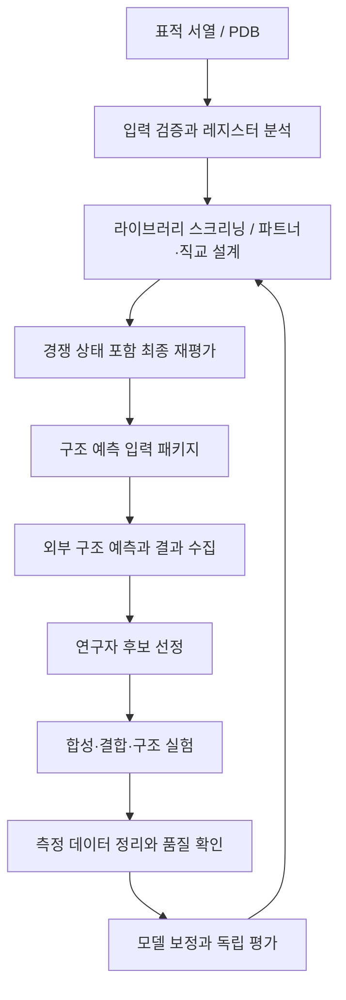

# LZ-program 연구 과정의 자동화·효율화 계획

작성일: 2026-10-18

기준 소스: `LZ-program/`, 커밋 `9b72e00cfd793a27de0bf37cccabea40064f9743`

문서 상태: 원본 코드와 README/DECISIONS에 근거한 개선 제안. 연구실의 실제 실험 운영·장비·GPU 환경은 아직 확인되지 않았다. 아래 우선순위는 구현 순서 제안이며 절감률이나 실험 성공률을 측정한 결과는 아니다.

## 1. 연구 흐름과 자동화 목표

원본 저장소의 연구 흐름은 **표적 입력 → 레지스터 분석 → 후보 탐색·설계 → 경쟁 결합 평가 → 구조 예측으로 전달 → 실험 검증 → 측정 데이터로 보정**이다. 저분자 도킹 준비는 단백질 연결 파트너 설계와 목적이 다른 선택적 분기다.

현재 자동화된 계산은 많지만, 실행 간 비교·외부 예측 결과 회수·실험 데이터 연결은 파일과 연구자의 수작업에 크게 의존한다. 우선 목표는 실행을 대량으로 늘리는 것보다, 같은 기준으로 후보를 비교하고 다음 단계에 정확히 전달하며 재현할 수 있게 만드는 것이다.

## 2. 단계별 자동화 기회

| 단계 | 현재 구현·부족한 연결 | 자동화할 작업 | 사람이 판단할 부분 | 우선순위 |
|---|---|---|---|---|
| 표적 수집 | PDB 다운로드 스크립트, 직접 파일·서열 입력 | 파일 해시·출처·잔기 범위 기록, 중복 입력 검출 | 연구 목적에 맞는 표적/construct 선택 | P0 |
| 입력 품질 | 서열 alphabet 검사, 구조·배향 경고 | 표준 QC 보고서, 다중 FASTA 처리 규칙, 구조/서열 일치 검사 | 불완전 구조와 모호한 레지스터의 채택 | P0 |
| 라이브러리 | 기본 5개, 출처·recall 필드 | 검증 상태·버전·정규화·중복 관리, 일괄 screening | 원문 서열 확인과 근거 승인 | P1 |
| 후보 설계 | 단일 실행과 seed/restarts/steps 옵션 | 다중 seed 실행, 조건별 비교, 중복·유사 후보 정리 | 설계 제한·후보 다양성의 목적 적합성 | P1 |
| 직교 평가 | 전체 행렬 최적화, shift 0 고정 | 최종 shift 재평가, 경쟁자 식별, 민감도 비교 | 모델 밖의 배향·올리고머 가능성 해석 | P0 |
| 구조 예측 전달 | FASTA 생성, 외부 실행 미구현 | 의도된 쌍/호모/교차 쌍 패키지, manifest | 계산 예산과 예측 도구 선택 | P0 |
| 예측 회수 | 지침 텍스트만 제공 | 도구별 결과 파싱, ID 연결, 요약·불일치 표시 | 신뢰도와 실제 결합 가능성 해석 | P1 |
| 실험 선정 | 연구자 수작업 | 후보 비교표, 다양성·대조군 포함 선정안 | 합성할 후보와 실험 조건 확정 | P1 |
| 실험 기록 | Tm CSV 입력만 존재 | 표준 양식, 단위·조건·반복 관리, 원자료 연결 | 실험 수행·이상치 처리 근거 | P1 |
| 보정 | 최소제곱·학습 R²/RMSE | 데이터 QC, 그룹 분할 평가, 모델 registry, 모델 비교 | 새 모델을 연구 기준으로 채택 | P1 |
| 도킹 분기 | 박스/receptor/config 생성 | 준비 상태 검사, 도구별 파일 검증 | 저분자 방해 연구로 진행할 가치 | P2 |
| 재현·보고 | 개별 파일 저장과 테스트 | 실행 manifest, 자동 보고서, 회귀 실행 | 결과의 과학적 주장과 발표 | P0 |

P0는 연구 결과의 연결·판정 정확성을 위한 선행 작업, P1은 반복 작업 절감, P2는 기반이 갖춰진 뒤의 확장이다.

## 3. 가장 먼저 자동화할 다섯 가지

### 3.1 실행 기록과 비교 보고서

모든 실행에 `project_id`, `target_id`, `run_id`를 부여하고 입력·설정·결과를 연결한다. 원본 서열, PDB에서 관측된 서열, 실험용 construct 서열은 별도 필드로 저장한다.

자동 산출물:

- 입력과 원자료 해시, 코드 커밋·의존성·라이브러리·점수 모델 버전.
- 사용 seed, restart별 seed, 반복 수, 온도, 고정 잔기, 허용 alphabet.
- 후보 서열·offset·점수 성분·경쟁자·최종 판정·경고.
- 실행 시간, 실패·취소·재실행 이력.
- 결과표 CSV/JSON, 사람용 Markdown 보고서, 다운로드 패키지.

완료 기준은 같은 조건의 실행을 다시 만들 수 있고, 결과 파일 하나에서 해당 입력과 모델까지 추적할 수 있는 것이다. 파일 이름이나 GUI 표의 정렬 순서로 후보를 식별하지 않는다.

### 3.2 입력 QC와 레지스터 검토 자료

표적 입력 시 표준 검사를 한 번 실행하고 이후 계산에서 재사용한다.

- 서열 정규화와 금지 문자 검사, 길이·고정 잔기 인덱스 검사.
- FASTA record가 여러 개면 자동 연결하지 않고 명시적인 표적 선택 또는 배치로 처리.
- PDB chain/model/잔기 범위, 누락 구간·수정 잔기·선택된 나선 구간 기록.
- 구조에서 측정한 offset과 서열 예측 offset의 비교.
- 역평행, 낮은 register fit, 거의 동률인 offset을 구조화된 경고로 저장.
- 구조 파일과 전체 construct의 길이 차이를 표시.

경고가 있다는 이유로 데이터를 버리기보다, 미검토·확인됨 상태와 연구자의 선택 근거를 기록한다. 평행 이중나선 가정에 맞지 않는 표적은 해당 모델의 통과 후보로 자동 승격하지 않는다.

### 3.3 경쟁 상태까지 포함한 자동 최종 재평가

현재 가장 중요한 개선 대상이다. `orthogonal.py`는 탐색과 행렬 계산에서 shift 0을 고정한다. 앞선 분석에서 seed 20의 2쌍 세트가 고정 shift에서는 통과하지만 일반 shift 탐색으로 재평가하면 한 쌍 margin이 -4.0351에서 -2.8954로 바뀌어 기본 기준 3.0에 미달했다.

자동화 규칙:

1. 탐색 결과에 대해 허용 shift를 고려한 최종 행렬을 다시 계산한다.
2. 각 의도된 쌍의 가장 강한 경쟁 상호작용과 shift를 저장한다.
3. 탐색 중 margin과 최종 margin을 함께 보고한다.
4. 기존 알고리즘의 threshold를 버전으로 고정하고 모델 기준 통과 여부를 계산한다.
5. screening과 partner design에서 어느 호모다이머를 경쟁자로 쓰는지 표시한다.

길이와 heptad offset이 같은 것만으로 shift 0이 최적이라는 가정을 두지 않는다. 최종 재평가는 결과 산출 단계에 공통으로 배치해 GUI/API/CSV/FASTA가 같은 판정을 사용하게 한다.

### 3.4 구조 예측용 복합체 패키지 생성

파트너 하나는 target:candidate와 두 호모다이머를 생성한다. 직교 세트는 단일 target 기준 export를 재사용하지 않고 전체 쌍 관계로 생성한다.

K쌍, N=2K개 사슬에 대해 대칭 중복을 제외한 이종 조합은 `N(N-1)/2`개, 호모다이머는 N개로, 전체 복합체는 `N(N+1)/2`개다. K=2이면 10개이며, 의도된 2개·호모 4개·기타 이종 4개로 나뉜다. README의 이종 상호작용 수에 호모다이머가 포함된 것으로 해석하지 않는다.

패키지는 다음을 포함한다.

- 각 복합체의 안정적인 ID와 두 서열, 의도된 쌍 여부.
- 도구별 입력 FASTA와 모델 설정 파일.
- 입력 hash와 source run ID가 담긴 manifest.
- 전체 조합 수·예상 작업 수·선택된 부분집합을 적은 목록.

조합이 커지면 전수 예측과 우선 예측을 선택할 수 있게 한다. 일부만 예측했으면 미평가 조합을 명시하며 전체 직교성이 검증됐다고 표시하지 않는다. ColabFold의 콜론 구분 FASTA를 모든 AlphaFold 구현이 동일하게 받는다고 가정하지 않고 어댑터별 포맷을 검증한다.

### 3.5 보정 데이터에서 모델까지 연결

현재 `calibrate`는 회귀 계수와 절편을 구하지만 상대 가중치만 저장한다. 보정 JSON·예측·보고서를 하나의 모델 버전으로 연결한다.

자동화할 내용:

- `sequence1, sequence2, tm` 외에 온도 단위·버퍼·pH·농도·실험법·반복·construct ID를 저장.
- 결측값, 단위 오류, 같은 표본의 중복과 조건 차이를 검사.
- 분할 전에 역순 서열 쌍을 같은 대상으로 묶고, 유사 서열/동일 construct를 그룹으로 분리해 누출을 줄임.
- 표본이 충분하면 그룹별 교차검증, 부족하면 검증 불충분 상태와 학습 오차만 보고.
- slope/intercept, 가중치, 학습 데이터 버전, 분할 규칙, 성능을 모델에 보관.
- 새 모델로 고정 벤치마크와 과거 후보를 재평가하고 차이를 비교.

학습 R²가 높다는 이유만으로 모델을 자동 채택하지 않는다. 기본 모델 변경은 연구자가 독립 평가와 적용 범위를 확인한 뒤 수행한다. 서로 다른 실험 조건을 무조건 같은 Tm 모델로 합치지 않는다.

## 4. 후보 설계 반복의 효율화

### 배치 실행과 탐색 계획

연구자는 표적·모델·설계 제약을 지정하고 서버가 seed/restarts/steps 조합을 배치 실행한다. 각 실행은 독립 run 또는 child run으로 추적한다. 비교표에는 최종 specificity, 목표 margin 충족률, 최악 교차 반응, 서열 다양성, 실행 시간을 넣는다.

처음에는 작은 탐색 예산으로 여러 seed를 평가하고, 추가 계산은 기준을 만족할 가능성이 있는 조건에 배분하는 방식을 제안한다. 절감 효과는 후보 품질과 완료 시간의 실제 측정으로 확인한다. 계산 예산이 줄었다고 연구 성능이 좋아졌다고 결론 내리지 않는다.

### 중복과 다양성

현재 `design.py`는 완전히 동일한 서열만 제거한다. 여기에 Hamming 거리 또는 위치별 유사도 기반 군집을 추가하고, 각 군집 대표 후보를 제안한다. 코어 a/d와 전하 e/g 패턴의 다양성도 따로 보여준다.

군집 기준은 명시적으로 저장한다. 단순히 상위 점수 N개를 선택할 때 생기는 거의 같은 후보의 중복 합성을 줄이되, 가까운 서열의 중요한 효과를 자동 삭제하지 않고 원래 후보를 보관한다.

## 5. 계산 성능 개선의 구체적 지점

| 대상 | 현재 코드의 관찰 | 개선안 | 검증 방법 |
|---|---|---|---|
| `design._objective` | 변이마다 서열·레지스터·접촉과 shift를 반복 계산 | 초기에는 점수 테이블·불변 정보 재사용, 이후 국소 변이의 영향 항만 갱신 | 무작위 서열/변이/shift에서 전체 계산과 허용 오차 내 일치 |
| `scoring.score_pair` | 점수 비교 중 Contact 객체를 반복 생성 | 최적화용 scalar 경로와 최종 설명용 contact 경로 분리 | 최종 점수·최적 shift·동률 처리 일치 |
| `orthogonal._update_row` | 이미 변이 사슬과 관련된 행만 갱신 | 기존 최적화 유지, 전체 재계산으로 퇴행시키지 않음 | 행렬 일치 회귀 |
| `orthogonal._objective` | 매 step 전체 행렬의 penalty를 순회 | 변이 행과 연결된 cognate 변화의 penalty를 증분 갱신 | 누락 항·이중 계산을 전체 목적함수와 비교 |
| 독립 restart | 순차 실행 | 별도 CPU 프로세스에 분배, seed를 사전에 확정 | 같은 seed 목록의 직렬/병렬 결과 집합 비교 |
| 반복 표적·모델 | 동일 분석이 재실행될 수 있음 | 입력·offset·가중치·모델 버전·shift 정책별 캐시 | 캐시 사용/미사용 결과 일치, 버전 변경 시 무효화 |

캐시는 모든 변이 서열을 무제한 저장하지 않는다. 재사용률이 높은 표적 self score·입력 분석·최종 후보에 우선 적용하고 용량을 제한한다. 점수의 사슬 순서를 바꿔 캐시할 때 shift 부호와 접촉 설명도 함께 변환해야 하므로, 초기에는 순서 있는 키를 사용하는 편이 단순하다.

프로파일링은 표적 길이·쌍 수·steps·seed를 고정해 수행한다. 속도 개선과 함께 후보 품질·정확성 회귀를 측정한다. 조기 종료는 온도와 탐색 다양성에 영향을 주므로 기본 켜짐으로 도입하지 않는다.

## 6. 외부 구조 예측 결과 수집

첫 버전은 실행된 도구의 결과 파일을 가져오는 방식으로 시작한다. 자동 실행은 실제 사용 도구·GPU/원격 환경·계정·저장 경로가 정해진 후 연결한다.

어댑터는 실행 도구와 버전별로 다음을 내부 포맷으로 변환한다.

- 복합체 ID, 모델/seed ID, 예측 구조 파일.
- 제공되는 경우 ipTM, pTM, pLDDT, chain 간 PAE 요약.
- 예측 구조에서 다시 측정한 배향·나선 구간·레지스터.
- 이종/호모/교차 조합의 점수·구조 차이.
- 누락된 지표, 실패한 작업, 입력과 결과의 서열 불일치.

ipTM 같은 신뢰도 지표를 결합 친화도나 열역학적 특이성으로 치환하지 않는다. 원본의 triage 지침은 참고로 보관하되 지표 차이만으로 합성 후보를 자동 확정하지 않는다. 모델 점수와 구조 예측이 충돌하면 우선 검토할 후보로 분류한다.

## 7. 실험 단계의 효율화

실험 자동화의 첫 범위는 장비 제어가 아니라 **선정안·샘플표·대조군·원자료 연결**이다.

- 후보 ID와 주문용 서열, tag/linker·말단 수정 사항을 구분한 발주 준비표.
- heterodimer뿐 아니라 target/candidate homodimer, 직교 off-target을 포함한 대조군 매트릭스.
- Tm/CD, SEC-MALS, 결합 측정 등 연구자가 선택한 실험 종류별 기록 양식.
- 샘플 ID·batch·반복·조건·원자료 경로와 실행 후보 ID 연결.
- 결과 입력 시 누락 조건과 단위 불일치 표시, 제외 데이터와 제외 사유 보관.

코돈 최적화·클로닝·장비 실행은 현재 저장소에 없는 범위다. 단백질 서열을 자동으로 DNA 주문 결과까지 확장하지 않는다. 실험 수행과 최종 후보 확정은 연구자의 업무로 둔다.

## 8. 저분자 도킹 분기

현재 `dockprep`은 도킹 실행·저분자 점수 계산을 제공하지 않는다. 해당 분기는 지퍼 결합을 방해하려는 별도 연구에서 선택한다.

우선 가능한 자동화는 receptor/box/config의 일관성 검사다. 현재 생성 config는 receptor PDB를 가리키므로, PDBQT 변환 후 실제 Vina 입력에 맞게 receptor 참조를 갱신하는 단계를 명시적으로 추가해야 한다. 양성자화·전하·리간드 준비 조건, 사용 엔진 버전과 seed도 기록한다.

도킹 실행이 연결되더라도 표면의 특성 때문에 점수 순위를 실험적 결합으로 해석할 수 없다. 실행 자동화와 결과 해석을 구분하며, 이 분기를 단백질 연결 파트너 설계의 필수 단계에 넣지 않는다.

## 9. 실행 우선순위와 측정 지표

| 순서 | 묶음 | 주요 산출물 | 완료 확인 |
|---|---|---|---|
| 1 | 연구 실행 기반 | FastAPI 작업·입력·manifest·결과 저장 | 중단·재실행 후 계보 보존 |
| 2 | 평가와 전달 정확성 | 최종 shift 재평가, specificity 정의, 직교 export | seed 20 회귀, 2쌍 10복합체 목록 검증 |
| 3 | 반복 설계 효율화 | 배치·다중 seed·비교표·다양성 | 동일 예산에서 품질과 후보 중복률 측정 |
| 4 | 예측·실험 연결 | 결과 parser·후보 선정표·측정 양식 | 파일 import에서 후보·실험까지 추적 |
| 5 | 보정과 성능 개선 | 모델 registry·그룹 검증·프로파일링 | 독립 평가 및 기존 모델 대비 결과 비교 |

운영 지표는 수작업 개입 횟수, 입력부터 비교표까지 걸린 시간, 중복 실행·후보 비율, 실패 복구율, 외부 결과 미연결 비율이다. 연구 지표는 최종 모델 margin 통과율, 독립 데이터 오차, 실험 단계별 성공률을 별도로 측정한다. 현재는 기준선이 없으므로 먼저 소규모 배치에서 측정하고 개선 목표를 정한다.

## 10. 근거와 다음 설계에 필요한 정보

이 문서의 현재 상태 판단은 원본의 `README.md`, `DECISIONS.md`, `CONTRIBUTING.md`와 `lz/design.py`, `orthogonal.py`, `scoring.py`, `export.py`, `dockprep.py`, `cli.py`, `gui.py`에 근거한다. 실제 구조 포함 테스트 143개 통과와 추가 재현 결과는 [기존 분석](LZ-program-analysis.md)에 정리되어 있다. 이 테스트 결과는 생물학적 예측 성능을 입증하는 자료와 구분한다.

초기 구현은 로컬 단일 사용자와 파일 기반 외부 연계를 가정해 진행할 수 있다. 후속 범위를 구체화할 때는 표적 수·서열 길이·직교 쌍 수, 사용 구조 예측 도구와 계산 환경, 기존 실험 데이터의 규모·조건, 연구실 공동 사용 여부를 확인한다.

관련 문서: [FastAPI 전환 아키텍처](01-fastapi-architecture.md).
